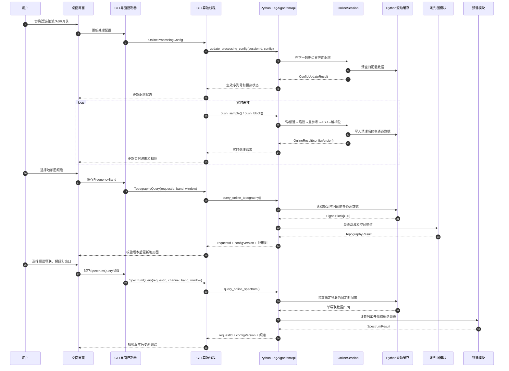
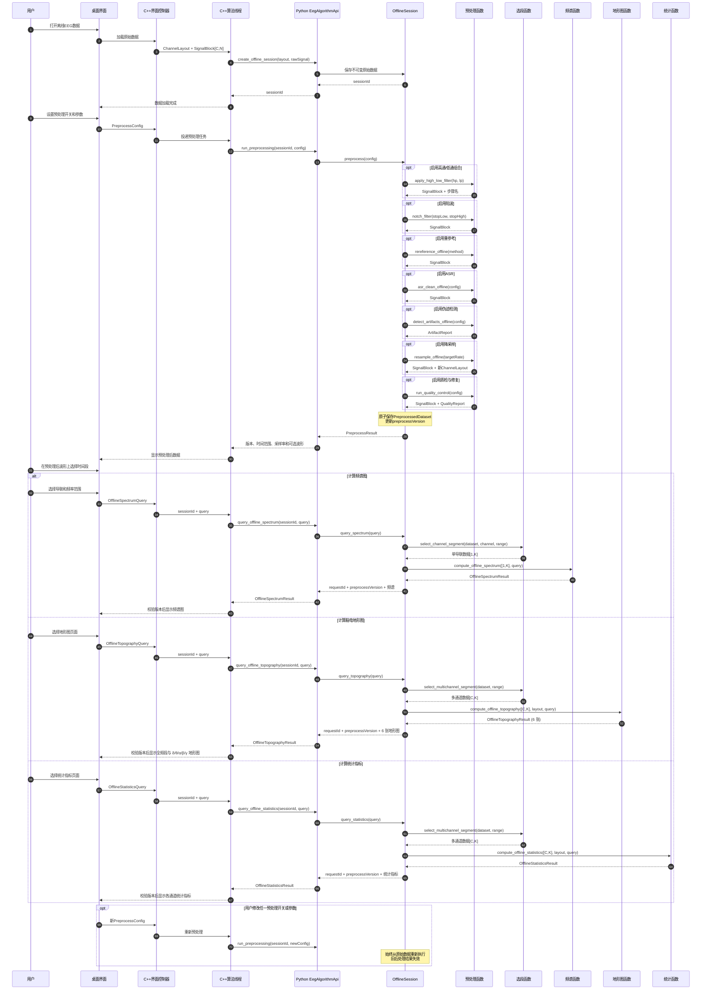

# EEG 在线与离线算法模块接口文档

| 项目 | 内容 |
| --- | --- |
| 文档版本 | v1.1-draft |
| 适用范围 | EEG 在线与离线算法模块 |
| 调用方式 | C++ 使用 pybind11 调用 Python |
| Python 公共模块 | `eeg_algorithm.api` |
| Python DTO 模块 | `eeg_algorithm.types` |
| Python 内部模块 | `eeg_algorithm.internal` |
| 信号类型与单位 | `numpy.float32`，`μV` |
| 相位单位 | 弧度，范围 `[-π, π)` |

## 1. 文档范围

本文定义 EEG 在线与离线算法相关接口，包括：

1. C++ 可以调用的 Python 公共接口。
2. Python 在线与离线算法模块内部接口。
3. C++ 与 Python 之间传递的 DTO、枚举和异常。
4. 在线滤波、陷波、重参考、ASR、实时解相位、脑电地形图和频谱分析的调用关系。
5. 离线预处理、预处理后数据管理、选段、离线频谱、离线脑电地形图和离线统计指标的调用关系。

本文不定义 Qt 界面、C++ 采集类、线程类、设备驱动、环形缓冲区实现或文件格式。离线后处理首版包含频谱图、脑电地形图和多通道统计指标，不包含其他统计指标或时频分析。

## 2. 总体数据流

### 2.1 在线模块

在线模块同时包含三类调用：

- **数据调用**：C++ 持续调用 `push_sample()` 或 `push_block()` 传入采集数据。
- **配置调用**：界面上的滤波、陷波和 ASR 开关发生变化时，C++ 调用 `update_processing_config()`。
- **查询调用**：界面需要刷新地形图或频谱时，C++ 调用对应查询接口。

```text
C++采集数据
    → 高通/低通
    → 陷波
    → 重参考
    → ASR
    ├── 实时解相位 → OnlineResult → C++桌面
    └── Python滚动缓存
          ├── 多通道时间窗 → 频段滤波 → 地形图 → C++桌面
          └── 单导联固定时间窗 → PSD → 频谱 → C++桌面
```

滚动缓存只保存当前处理配置下，完成高通/低通、陷波、重参考和 ASR 后的数据。处理配置变化时必须清空缓存，避免混合不同处理条件的数据。

### 2.2 离线模块

离线模块分为预处理和后处理两个阶段：

```text
C++完整原始数据
    → Python OfflineSession
    → 离线预处理
         高通/低通 → 陷波 → 重参考 → ASR → 伪迹检测 → 降采样 → 质检与修复
    → 版本化PreprocessedDataset
         ├── 选段 + 单导联 → PSD → 频谱图 → C++桌面
         ├── 选段 + 多通道 + 电极坐标 → 全频段/δ/θ/α/β/γ 地形图（6 张） → C++桌面
         └── 选段 + 多通道 → 统计指标（均值/标准差/RMS/峰值/极值/零交叉率/偏度/峰度/优势频带） → C++桌面
```

C++ 只在创建离线会话时传入完整原始数据。后处理时只传会话 ID、预处理版本、选段范围和分析参数，Python 从 `PreprocessedDataset` 中截取数据，不要求 C++ 把预处理结果再次传回 Python。

## 3. 通用数据约定

### 3.1 数组形状

| 数据 | dtype | 形状 | 说明 |
| --- | --- | --- | --- |
| 单采样点 | `numpy.float32` | `[C]` | 一个时刻的全部通道 |
| 连续数据块 | `numpy.float32` | `[C,N]` | `N` 为本次数据阶长 |
| 时间戳 | `numpy.int64` | `[N]` | 单位 ns，严格递增 |
| 在线频谱 | `numpy.float32` | `[F]` | 单导联 PSD |
| 地形图网格 | `numpy.float32` | `[H,W]` | 二维插值结果 |

约定：

- `C` 为会话固定通道数，`N` 为样本数，`F` 为频点数。
- 数组必须为 C-contiguous。
- 电压单位固定为 `μV`，频率单位为 `Hz`，时间窗单位为 `s`。
- `timestamp_ns` 使用单调时钟域中的 `int64` 纳秒值。
- `sequence_id` 使用连续递增的非负整数。
- 时间区间采用左闭右开 `[start,end)`。
- 输入数组默认不允许包含 NaN 或 Inf。
- C++ 以零拷贝方式传入数组时，内存至少保持到本次 Python 调用返回；Python 不得跨调用保存外部视图。
- Python 保存历史窗口时必须复制到 Python 自有内存。

### 3.2 版本与请求标识

- `config_version` 标识当前在线处理配置，创建会话时必须大于 0。
- 每次修改高通、低通、陷波或 ASR 开关时，C++ 必须提供更大的 `config_version`。
- `preprocess_version` 标识离线预处理结果；每次重新运行预处理时必须递增。
- `request_id` 由 C++ 为每次地形图或频谱查询生成，并在对应会话内严格递增。
- 在线结果带回 `request_id` 和 `config_version`；离线结果带回 `request_id` 和 `preprocess_version`。
- C++ 只显示与当前请求及当前数据版本一致的结果，过期结果直接丢弃。

## 4. 枚举定义

```python
from enum import Enum


class ReferenceMethod(Enum):
    OFF = "off"
    BILATERAL_MASTOIDS = "bilateral_mastoids"
    COMMON_AVERAGE = "common_average"


class BandPreset(Enum):
    DELTA = "delta"                  # 0.5–4 Hz
    THETA = "theta"                  # 4–8 Hz
    ALPHA = "alpha"                  # 8–13 Hz
    BETA = "beta"                    # 13–30 Hz
    GAMMA = "gamma"                  # 30–45 Hz
    FULL_0_5_30 = "full_0_5_30"      # 0.5–30 Hz
    CUSTOM = "custom"


class QualityFlag(Enum):
    OK = "ok"
    WARMING_UP = "warming_up"
    DATA_GAP = "data_gap"
    ARTIFACT = "artifact"
    MODEL_INVALID = "model_invalid"
    TIMEOUT = "timeout"


class SessionState(Enum):
    CREATED = "created"
    WARMING_UP = "warming_up"
    RUNNING = "running"
    DEGRADED = "degraded"
    ERROR = "error"
    CLOSED = "closed"


class OfflineSessionState(Enum):
    RAW_READY = "raw_ready"
    PREPROCESSING = "preprocessing"
    PREPROCESSED = "preprocessed"
    ERROR = "error"
    CLOSED = "closed"
```

频段预设：

| 预设 | 范围 |
| --- | ---: |
| `DELTA` | 0.5–4 Hz |
| `THETA` | 4–8 Hz |
| `ALPHA` | 8–13 Hz |
| `BETA` | 13–30 Hz |
| `GAMMA` | 30–45 Hz |
| `FULL_0_5_30` | 0.5–30 Hz |

`FULL_0_5_30` 不包含 Gamma，界面应显示“0.5–30 Hz”，不应显示为包含全部频率的“全频段”。

## 5. 输入 DTO

以下 DTO 位于 `eeg_algorithm.types`，使用不可变 `dataclass`。

### 5.1 通道与采样数据

```python
from dataclasses import dataclass
import numpy as np
from numpy.typing import NDArray


@dataclass(frozen=True)
class ElectrodePosition:
    channel_name: str
    x: float
    y: float
    z: float
    coordinate_system: str


@dataclass(frozen=True)
class ChannelLayout:
    channel_names: tuple[str, ...]
    sample_rate_hz: float
    positions: tuple[ElectrodePosition, ...] = ()
    unit: str = "uV"


@dataclass(frozen=True)
class SampleFrame:
    sequence_id: int
    timestamp_ns: int
    values: NDArray[np.float32]       # [C]


@dataclass(frozen=True)
class SignalBlock:
    first_sequence_id: int
    timestamps_ns: NDArray[np.int64]  # [N]
    values: NDArray[np.float32]       # [C,N]


@dataclass(frozen=True)
class AbsoluteTimeRange:
    start_timestamp_ns: int
    end_timestamp_ns: int


@dataclass(frozen=True)
class GapInfo:
    first_missing_sequence_id: int
    last_missing_sequence_id: int
    start_timestamp_ns: int
    end_timestamp_ns: int
    reason: str
```

校验规则：

- `channel_names` 必须非空且唯一，会话运行中不得改变数量或顺序。
- `sample_rate_hz > 0`。
- `SampleFrame.values.shape == (C,)`。
- `SignalBlock.values.shape == (C,N)`。
- `len(SignalBlock.timestamps_ns) == N`。
- 数据块中的第 `i` 个样本序列号为 `first_sequence_id + i`。
- `GapInfo` 的首尾序列号均包含在丢失范围内。

### 5.2 在线处理配置

```python
@dataclass(frozen=True)
class ToggleFilterConfig:
    enabled: bool
    low_hz: float | None = None
    high_hz: float | None = None
    order: int = 4


@dataclass(frozen=True)
class OnlineProcessingConfig:
    config_version: int
    high_pass: ToggleFilterConfig
    low_pass: ToggleFilterConfig
    notch: ToggleFilterConfig
    asr_enabled: bool


@dataclass(frozen=True)
class ReferenceConfig:
    method: ReferenceMethod = ReferenceMethod.OFF
    mastoid_channels: tuple[str, ...] = ()


@dataclass(frozen=True)
class AsrConfig:
    cutoff: float = 20.0
    window_s: float | None = None
    overlap_ratio: float | None = None
    reference_duration_s: float | None = None


@dataclass(frozen=True)
class PhaseModelConfig:
    enabled: bool
    model_path: str
    target_channels: tuple[str, ...]
    device: str = "cpu"              # cpu | cuda
    window_samples: int = 1


@dataclass(frozen=True)
class OnlineConfig:
    layout: ChannelLayout
    processing: OnlineProcessingConfig
    reference: ReferenceConfig
    asr: AsrConfig
    phase: PhaseModelConfig
    rolling_window_s: float
    return_processed_signal: bool = True
```

滤波约定：

- v1 固定使用四阶 Butterworth，`order` 必须为 `4`。
- 高通启用时 `high_pass.low_hz` 必填。
- 低通启用时 `low_pass.high_hz` 必填。
- 陷波启用时 `notch.low_hz` 和 `notch.high_hz` 必填，默认建议 `48–52 Hz`。
- 频率必须满足 `0 < f < sample_rate_hz / 2`。
- `rolling_window_s` 必须不小于界面允许选择的最大地形图或频谱窗口。

重参考约定：

- `OFF`：不执行重参考。
- `BILATERAL_MASTOIDS`：减去两个乳突通道的均值，`mastoid_channels` 必须恰好包含两个有效通道。
- `COMMON_AVERAGE`：减去所有有效 EEG 通道的均值。

ASR 约定：

- `cutoff` 默认 `20`。
- 参考数据时长必须位于 `60–180 s`。
- `asr_enabled=True` 时，`window_s` 和 `overlap_ratio` 必填。
- `window_s > 0`，`0 <= overlap_ratio < 1`。

### 5.3 查询配置

```python
@dataclass(frozen=True)
class FrequencyBand:
    preset: BandPreset
    low_hz: float
    high_hz: float


@dataclass(frozen=True)
class TopographyQuery:
    request_id: int
    band: FrequencyBand
    window_s: float | None = None
    time_range: AbsoluteTimeRange | None = None
    grid_width: int = 64
    grid_height: int = 64


@dataclass(frozen=True)
class SpectrumQuery:
    request_id: int
    channel_name: str
    band: FrequencyBand
    window_s: float
```

查询规则：

- `FrequencyBand.low_hz < FrequencyBand.high_hz`。
- 频段必须位于 Nyquist 频率以内，并位于当前高通/低通配置保留的范围内。
- 非 `CUSTOM` 预设的上下边界必须与第 4 节的标准范围一致。
- `TopographyQuery.window_s` 和 `time_range` 必须且只能填写一个。
- `SpectrumQuery.channel_name` 必须存在于当前通道布局。
- `SpectrumQuery.window_s > 0` 且不得超过 `OnlineConfig.rolling_window_s`。
- 地形图需要通道布局中包含足够的电极坐标。

### 5.4 离线预处理与后处理配置

```python
@dataclass(frozen=True)
class HighPassConfig:
    enabled: bool
    cutoff_hz: float


@dataclass(frozen=True)
class LowPassConfig:
    enabled: bool
    cutoff_hz: float


@dataclass(frozen=True)
class NotchConfig:
    enabled: bool
    stop_low_hz: float = 48.0
    stop_high_hz: float = 52.0


@dataclass(frozen=True)
class OfflineReferenceConfig:
    enabled: bool
    method: ReferenceMethod = ReferenceMethod.OFF
    mastoid_channels: tuple[str, ...] = ()


@dataclass(frozen=True)
class OfflineAsrConfig:
    enabled: bool
    cutoff: float = 20.0
    window_s: float | None = None
    overlap_ratio: float | None = None
    reference_range: AbsoluteTimeRange | None = None


@dataclass(frozen=True)
class ArtifactDetectionConfig:
    enabled: bool = True
    jump_ratio: float = 5.0
    high_freq_hz: float = 30.0
    high_freq_ratio: float = 0.5


@dataclass(frozen=True)
class ResampleConfig:
    enabled: bool
    target_rate_hz: float


@dataclass(frozen=True)
class QualityControlConfig:
    null_weak_enabled: bool = True
    amplitude_outlier_enabled: bool = True
    low_correlation_enabled: bool = True
    repair_enabled: bool = False
    amplitude_ratio: float = 0.1
    correlation_threshold: float = 0.1
    weak_signal_threshold_uv: float = 1.0


@dataclass(frozen=True)
class ArtifactSegment:
    channel_name: str
    artifact_type: str
    start_sample: int
    end_sample: int
    start_timestamp_ns: int
    end_timestamp_ns: int


@dataclass(frozen=True)
class ArtifactReport:
    segments: tuple[ArtifactSegment, ...]
    artifact_mask: NDArray[np.bool_]


@dataclass(frozen=True)
class QualityReport:
    segments: tuple[ArtifactSegment, ...]
    artifact_mask: NDArray[np.bool_]
    repaired: bool


@dataclass(frozen=True)
class PreprocessConfig:
    preprocess_version: int
    high_pass: HighPassConfig
    low_pass: LowPassConfig
    notch: NotchConfig
    reference: OfflineReferenceConfig
    asr: OfflineAsrConfig
    artifact: ArtifactDetectionConfig
    resample: ResampleConfig
    quality_control: QualityControlConfig = QualityControlConfig()
    return_processed_signal: bool = True


@dataclass(frozen=True)
class OfflineSpectrumQuery:
    request_id: int
    preprocess_version: int
    channel_name: str
    selected_range: AbsoluteTimeRange
    frequency_range_hz: tuple[float, float] | None = None


@dataclass(frozen=True)
class OfflineTopographyQuery:
    request_id: int
    preprocess_version: int
    selected_range: AbsoluteTimeRange
    grid_width: int = 64
    grid_height: int = 64


@dataclass(frozen=True)
class OfflineStatisticsQuery:
    request_id: int
    preprocess_version: int
    selected_range: AbsoluteTimeRange
```

离线配置规则：

- 固定预处理顺序为：高通/低通组合 → 陷波 → 重参考 → ASR → 伪迹检测 → 降采样 → 质检与修复；关闭的步骤直接跳过。
- 高通/低通组合规则：两者都启用时做带通（要求 `0 < cutoff_hp < cutoff_lp < sample_rate_hz / 2`）；仅高通启用时做高通；仅低通启用时做低通。
- 陷波启用时满足 `0 < stop_low_hz < stop_high_hz < sample_rate_hz / 2`。
- 降采样启用时满足 `0 < target_rate_hz <= 当前采样率`，并先进行抗混叠滤波。
- ASR 的 `reference_range` 为空时，由算法从原始记录中自动选择有效参考段；不能获得有效参考时抛出 `ASR_REFERENCE_REQUIRED`。
- 伪迹检测与 ASR 去伪迹同级，只检测不修改信号；启用时检测跳变伪迹（一阶差分超过中位数差分的 `jump_ratio` 倍）与高频能量伪迹（1 秒窗口内高通分量能量占比超过 `high_freq_ratio`），任一命中即标记，返回伪迹异常段列表与逐样本掩码。
- 质检检测项：空值与弱信号（`null_weak_enabled`）、异常 EEG 范围外值/幅度占比（`amplitude_outlier_enabled`）、低相关性导联/相关性（`low_correlation_enabled`），每个小项都有独立开关；检测始终返回异常段列表与逐样本掩码。
- 修复开关 `repair_enabled`：off 仅标注不修改数据；on 对异常样本用左右正常值做线性插值修复，并在 `applied_steps` 中追加 `repair`。
- 后处理的 `selected_range` 必须位于当前 `PreprocessedDataset` 的时间范围内；选段使用时间戳，不使用采样点下标。
- 频谱查询只读取所选导联；地形图查询读取选段内全部有效通道，并要求电极坐标完整，一次返回全频段与 δ/θ/α/β/γ 共 6 张地形图。
- 统计查询读取选段内全部通道，逐通道计算均值、标准差、RMS、峰峰值、最小值、最大值、零交叉率、偏度、峰度与优势频带，并返回通道相关性矩阵（皮尔逊相关系数）与各通道 δ/θ/α/β/γ 频带能量（PSD 积分）。
- 后处理查询中的 `preprocess_version` 必须等于离线会话当前版本，否则抛出 `STALE_DATA_VERSION`。

## 6. 输出 DTO

### 6.1 实时处理结果

```python
@dataclass(frozen=True)
class PhaseValue:
    channel_name: str
    phase_rad: float
    valid: bool
    confidence: float | None = None


@dataclass(frozen=True)
class PhaseResult:
    sequence_id: int
    timestamp_ns: int
    values: tuple[PhaseValue, ...]
    processing_time_us: int
    quality_flags: tuple[QualityFlag, ...]


@dataclass(frozen=True)
class OnlineResult:
    config_version: int
    first_sequence_id: int
    last_sequence_id: int
    processed_signal: SignalBlock | None
    phase_results: tuple[PhaseResult, ...]
    quality_flags: tuple[QualityFlag, ...]
    processing_time_us: int
```

约定：

- `processed_signal` 是完成高通/低通、陷波、重参考和 ASR 后的数据。
- `return_processed_signal=False` 时，`processed_signal=None`。
- 单目标模型的 `PhaseResult.values` 长度为 1。
- 预热、伪迹或模型拒绝输出时使用 `valid=False`，不得使用 NaN 表示无效相位。

### 6.2 配置更新结果

```python
@dataclass(frozen=True)
class ConfigUpdateResult:
    config_version: int
    effective_sequence_id: int
    rolling_buffer_cleared: bool
    asr_refit_required: bool
    warmup_required: bool
```

- `effective_sequence_id` 表示新配置生效的第一个序列号。
- `rolling_buffer_cleared` 表示旧配置数据是否已从分析缓存清除。
- `asr_refit_required=True` 表示 C++ 必须重新调用 `set_asr_reference()`。

### 6.3 地形图结果

```python
@dataclass(frozen=True)
class TopographyResult:
    request_id: int
    config_version: int
    band: FrequencyBand
    actual_time_range: AbsoluteTimeRange
    grid_x: NDArray[np.float32]            # [W]
    grid_y: NDArray[np.float32]            # [H]
    grid_values: NDArray[np.float32]       # [H,W]
    head_mask: NDArray[np.bool_]           # [H,W]
    electrode_values: NDArray[np.float32]  # [C]
    electrode_names: tuple[str, ...]
```

### 6.4 频谱结果

```python
@dataclass(frozen=True)
class SpectrumResult:
    request_id: int
    config_version: int
    channel_name: str
    band: FrequencyBand
    actual_time_range: AbsoluteTimeRange
    frequencies_hz: NDArray[np.float32]    # [F]
    psd: NDArray[np.float32]               # [F]
```

### 6.5 会话状态

```python
@dataclass(frozen=True)
class SessionStatus:
    state: SessionState
    config_version: int
    last_processed_sequence_id: int | None
    average_processing_time_us: float
    p99_processing_time_us: float
    max_processing_time_us: int
    gap_count: int
    timeout_count: int
    warmup_remaining_samples: int
    rolling_buffer_duration_s: float
    last_error: "AlgorithmErrorInfo | None"
```

### 6.6 离线预处理与后处理结果

```python
@dataclass(frozen=True)
class PreprocessedDataset:
    preprocess_version: int
    layout: ChannelLayout
    signal: SignalBlock
    actual_time_range: AbsoluteTimeRange
    applied_steps: tuple[str, ...]


@dataclass(frozen=True)
class PreprocessResult:
    preprocess_version: int
    layout: ChannelLayout
    actual_time_range: AbsoluteTimeRange
    sample_count: int
    processed_signal: SignalBlock | None
    applied_steps: tuple[str, ...]
    warnings: tuple[str, ...]
    quality_report: QualityReport | None = None
    artifact_report: ArtifactReport | None = None


@dataclass(frozen=True)
class OfflineSpectrumResult:
    request_id: int
    preprocess_version: int
    channel_name: str
    selected_range: AbsoluteTimeRange
    frequencies_hz: NDArray[np.float32]  # [F]
    psd: NDArray[np.float32]             # [F]


@dataclass(frozen=True)
class OfflineTopographyResult:
    request_id: int
    preprocess_version: int
    selected_range: AbsoluteTimeRange
    band_names: tuple[str, ...]             # ("full","delta","theta","alpha","beta","gamma")
    grid_x: NDArray[np.float32]            # [W]
    grid_y: NDArray[np.float32]            # [H]
    grid_values: NDArray[np.float32]       # [6,H,W]
    head_mask: NDArray[np.bool_]           # [H,W]
    electrode_values: NDArray[np.float32]  # [6,C]
    electrode_names: tuple[str, ...]


@dataclass(frozen=True)
class OfflineStatisticsResult:
    request_id: int
    preprocess_version: int
    selected_range: AbsoluteTimeRange
    channel_names: tuple[str, ...]
    mean: NDArray[np.float32]              # [C] 均值（μV）
    std: NDArray[np.float32]               # [C] 标准差（样本标准差，μV）
    rms: NDArray[np.float32]               # [C] 均方根（μV）
    peak_to_peak: NDArray[np.float32]      # [C] 峰峰值（μV）
    min_value: NDArray[np.float32]         # [C] 最小值（μV）
    max_value: NDArray[np.float32]         # [C] 最大值（μV）
    zero_crossing_rate: NDArray[np.float32]  # [C] 零交叉率（次/秒）
    skewness: NDArray[np.float32]          # [C] 偏度
    kurtosis: NDArray[np.float32]          # [C] 峰度（超额峰度）
    dominant_band: tuple[str, ...]         # [C] 优势频带（delta/theta/alpha/beta/gamma/none）
    correlation_matrix: NDArray[np.float32]  # [C,C] 通道皮尔逊相关系数矩阵
    band_names: tuple[str, ...]            # ("delta","theta","alpha","beta","gamma")
    band_energies: NDArray[np.float32]     # [C,5] 各频带能量（PSD 积分）


@dataclass(frozen=True)
class OfflineSessionStatus:
    state: OfflineSessionState
    preprocess_version: int | None
    raw_time_range: AbsoluteTimeRange
    preprocessed_time_range: AbsoluteTimeRange | None
    raw_sample_count: int
    preprocessed_sample_count: int | None
    last_error: "AlgorithmErrorInfo | None"
```

`PreprocessedDataset` 保存在 Python 离线会话中，作为全部后处理的唯一输入。`PreprocessResult.processed_signal` 仅在 `PreprocessConfig.return_processed_signal=True` 时返回给 C++，不影响 Python 内部保存完整预处理数据。

## 7. C++ 可调用的 Python 公共接口

公共模块为 `eeg_algorithm.api`。C++ 不应直接导入 `eeg_algorithm.internal`。

### 7.1 模块入口

```python
API_VERSION = "1.3"


def get_api_version() -> str: ...


def create_api() -> "EegAlgorithmApi": ...
```

- `get_api_version()` 返回在线与离线统一接口版本；C++ 必须在创建 API 对象前校验主版本号。
- `create_api()` 创建进程内唯一的 API 门面；重复调用返回同一对象。

### 7.2 `EegAlgorithmApi`

```python
class EegAlgorithmApi:
    def create_online_session(self, config: OnlineConfig) -> int: ...

    def set_asr_reference(
        self,
        session_id: int,
        reference: SignalBlock,
    ) -> None: ...

    def update_processing_config(
        self,
        session_id: int,
        config: OnlineProcessingConfig,
    ) -> ConfigUpdateResult: ...

    def push_sample(
        self,
        session_id: int,
        frame: SampleFrame,
    ) -> OnlineResult: ...

    def push_block(
        self,
        session_id: int,
        block: SignalBlock,
    ) -> OnlineResult: ...

    def notify_gap(
        self,
        session_id: int,
        gap: GapInfo,
    ) -> None: ...

    def query_online_topography(
        self,
        session_id: int,
        query: TopographyQuery,
    ) -> TopographyResult: ...

    def query_online_spectrum(
        self,
        session_id: int,
        query: SpectrumQuery,
    ) -> SpectrumResult: ...

    def reset_online_session(self, session_id: int) -> None: ...

    def get_online_status(self, session_id: int) -> SessionStatus: ...

    def close_online_session(self, session_id: int) -> None: ...

    def create_offline_session(
        self,
        layout: ChannelLayout,
        raw_signal: SignalBlock,
    ) -> int: ...

    def run_preprocessing(
        self,
        session_id: int,
        config: PreprocessConfig,
    ) -> PreprocessResult: ...

    def query_offline_spectrum(
        self,
        session_id: int,
        query: OfflineSpectrumQuery,
    ) -> OfflineSpectrumResult: ...

    def query_offline_topography(
        self,
        session_id: int,
        query: OfflineTopographyQuery,
    ) -> OfflineTopographyResult: ...

    def query_offline_statistics(
        self,
        session_id: int,
        query: OfflineStatisticsQuery,
    ) -> OfflineStatisticsResult: ...

    def get_preprocessed_data(
        self,
        session_id: int,
    ) -> PreprocessedDataset: ...

    def get_offline_status(
        self,
        session_id: int,
    ) -> OfflineSessionStatus: ...

    def close_offline_session(self, session_id: int) -> None: ...

    def close(self) -> None: ...
```

### 7.3 接口契约

| 接口 | 用途 | 状态影响 |
| --- | --- | --- |
| `create_online_session` | 校验配置、加载模型、创建在线状态 | 创建会话并进入预热 |
| `set_asr_reference` | 使用 1–3 分钟数据建立 ASR 参考 | 更新 ASR 参考，不推进业务序列 |
| `update_processing_config` | 应用滤波、陷波和 ASR 开关 | 在下一数据边界生效并重置受影响状态 |
| `push_sample` | 处理一个采样点 | 成功后序列推进 1 |
| `push_block` | 处理 `[C,N]` 连续数据块 | 成功后序列推进 N |
| `notify_gap` | 通知采集数据缺口 | 清空连续状态并重新预热 |
| `query_online_topography` | 查询指定窗口和频段的多通道地形图 | 只读 |
| `query_online_spectrum` | 查询指定导联、窗口和频段的频谱 | 只读 |
| `reset_online_session` | 清空流式状态，保留配置和模型 | 回到预热状态 |
| `get_online_status` | 查询会话及缓存状态 | 只读 |
| `close_online_session` | 释放会话资源 | 会话关闭 |
| `create_offline_session` | 保存完整原始数据和通道布局 | 创建 `RAW_READY` 离线会话 |
| `run_preprocessing` | 按开关和参数执行离线预处理 | 原子替换预处理数据并更新版本 |
| `query_offline_spectrum` | 从预处理数据选段并计算单导联频谱 | 只读 |
| `query_offline_topography` | 从预处理数据选段并计算脑电地形图 | 只读 |
| `query_offline_statistics` | 从预处理数据选段并逐通道计算统计指标 | 只读 |
| `get_preprocessed_data` | 获取完整预处理后数据，用于显示或导出 | 只读 |
| `get_offline_status` | 查询离线会话和数据版本 | 只读 |
| `close_offline_session` | 释放原始和预处理数据 | 会话关闭 |
| `close` | 关闭全部会话和 API 对象 | API 关闭 |

### 7.4 界面参数映射

| 界面控件 | DTO 字段 | 调用接口 |
| --- | --- | --- |
| 高通开关/截止频率 | `OnlineProcessingConfig.high_pass` | `update_processing_config()` |
| 低通开关/截止频率 | `OnlineProcessingConfig.low_pass` | `update_processing_config()` |
| 陷波开关/阻带范围 | `OnlineProcessingConfig.notch` | `update_processing_config()` |
| ASR 开关 | `OnlineProcessingConfig.asr_enabled` | `update_processing_config()` |
| 地形图频段 | `TopographyQuery.band` | `query_online_topography()` |
| 地形图时间窗 | `TopographyQuery.window_s/time_range` | `query_online_topography()` |
| 频谱导联 | `SpectrumQuery.channel_name` | `query_online_spectrum()` |
| 频谱频段 | `SpectrumQuery.band` | `query_online_spectrum()` |
| 频谱固定时间窗 | `SpectrumQuery.window_s` | `query_online_spectrum()` |
| 地形图/频谱刷新周期 | 不传入 Python 配置 | C++ 定时发起查询 |
| 离线高通开关及截止频率 | `PreprocessConfig.high_pass` | `run_preprocessing()` |
| 离线低通开关及截止频率 | `PreprocessConfig.low_pass` | `run_preprocessing()` |
| 离线陷波开关及阻带 | `PreprocessConfig.notch` | `run_preprocessing()` |
| 离线重参考开关及类别 | `PreprocessConfig.reference` | `run_preprocessing()` |
| 离线 ASR 开关及参数 | `PreprocessConfig.asr` | `run_preprocessing()` |
| 离线伪迹检测开关及参数 | `PreprocessConfig.artifact` | `run_preprocessing()` |
| 离线降采样开关及目标频率 | `PreprocessConfig.resample` | `run_preprocessing()` |
| 离线质检与修复开关及参数 | `PreprocessConfig.quality_control` | `run_preprocessing()` |
| 后处理选段 | `selected_range` | 离线频谱/地形图/统计查询接口 |
| 离线频谱导联及频率范围 | `OfflineSpectrumQuery` | `query_offline_spectrum()` |
| 离线地形图（全频段 + δ/θ/α/β/γ，共 6 张） | `OfflineTopographyQuery` | `query_offline_topography()` |
| 离线统计指标选段 | `OfflineStatisticsQuery.selected_range` | `query_offline_statistics()` |

### 7.5 公共接口行为规则

- 同一 `session_id` 同一时刻只允许执行一个调用。
- `push_sample()` 与 `push_block()` 共用同一流式状态。
- 相同初始状态下，一次 `push_block(N)` 与按顺序调用 N 次 `push_sample()` 的结果必须在数值容差内一致。
- 新处理配置只能在下一采样点或数据块边界生效，不允许在一个数据块中间切换。
- 处理配置变化后必须清空滚动缓存，并通过 `effective_sequence_id` 报告生效位置。
- 高通、低通或陷波变化会影响 ASR 输入分布。Python 应优先使用保存的原始参考数据自动重新拟合；无法自动拟合时返回 `asr_refit_required=True`。
- 输入校验失败不得推进序列号、滤波、ASR、模型或缓存状态。
- `notify_gap()` 后必须清空依赖连续数据的状态，预热完成前返回 `WARMING_UP` 或 `DATA_GAP`。
- `notify_gap()` 和 `reset_online_session()` 保留当前配置、已加载模型及有效的 ASR 参考数据，但清空滤波延迟、ASR 业务窗口、相位状态和滚动缓存。
- 查询窗口未积满时抛出 `INSUFFICIENT_WINDOW_DATA`，不得使用更短窗口静默计算。
- 离线原始数据在 `OfflineSession` 生命周期内保持不变；每次预处理都从原始数据重新开始，不在上一次预处理结果上叠加。
- `run_preprocessing()` 成功后原子替换 `PreprocessedDataset`；失败时保留上一版本，不返回半成品。
- 后处理只能读取当前 `PreprocessedDataset`，不得绕过预处理结果读取原始数据。
- 重新预处理会使旧的离线频谱和地形图结果失效；C++ 通过 `preprocess_version` 丢弃过期结果。
- 选段使用 `AbsoluteTimeRange` 而不是样本下标，避免降采样改变下标语义。
- `close()` 后，除重复 `close()` 外的调用均抛出 `INVALID_STATE`。

## 8. Python 内部接口

以下接口位于 `eeg_algorithm.internal`，只允许由 Python 公共门面和内部组件调用。

### 8.1 `OnlineSessionRegistry`

```python
class OnlineSessionRegistry:
    def create(self, config: OnlineConfig) -> int: ...
    def get(self, session_id: int) -> "OnlineSession": ...
    def close(self, session_id: int) -> None: ...
    def close_all(self) -> None: ...
```

负责分配不重复的非零会话 ID，并管理 `OnlineSession` 生命周期。

### 8.2 `OnlineSession`

```python
class OnlineSession:
    def __init__(self, config: OnlineConfig) -> None: ...

    def set_asr_reference(self, reference: SignalBlock) -> None: ...

    def update_processing_config(
        self,
        config: OnlineProcessingConfig,
    ) -> ConfigUpdateResult: ...

    def push_sample(self, frame: SampleFrame) -> OnlineResult: ...
    def push_block(self, block: SignalBlock) -> OnlineResult: ...
    def notify_gap(self, gap: GapInfo) -> None: ...
    def query_topography(self, query: TopographyQuery) -> TopographyResult: ...
    def query_spectrum(self, query: SpectrumQuery) -> SpectrumResult: ...
    def reset(self) -> None: ...
    def status(self) -> SessionStatus: ...
    def close(self) -> None: ...
```

`OnlineSession` 负责：

- 输入校验和序列连续性检查。
- 保存当前配置版本。
- 编排高通/低通、陷波、重参考、ASR 和相位解码。
- 将处理后的数据写入滚动缓存。
- 处理配置更新、缓存清空和重新预热。
- 从滚动缓存取得地形图和频谱所需数据。
- 只有在一次处理全部成功后才提交新状态，避免异常造成部分推进。

### 8.3 `OnlineFilterChain`

```python
class OnlineFilterChain:
    def __init__(
        self,
        config: OnlineProcessingConfig,
        sample_rate_hz: float,
        channel_count: int,
    ) -> None: ...

    def reconfigure(self, config: OnlineProcessingConfig) -> None: ...
    def process_sample(self, values: NDArray[np.float32]) -> NDArray[np.float32]: ...
    def process_block(self, values: NDArray[np.float32]) -> NDArray[np.float32]: ...
    def reset(self) -> None: ...
```

- 执行顺序固定为高通/低通后陷波。
- 使用因果 Butterworth SOS。
- 滤波状态跨调用保留。
- `reconfigure()` 清空旧滤波状态。
- 输出形状必须与输入一致。

### 8.4 `ReReferencer`

```python
class ReReferencer:
    def __init__(self, config: ReferenceConfig,
                 layout: ChannelLayout) -> None: ...
    def process_sample(self, values: NDArray[np.float32]) -> NDArray[np.float32]: ...
    def process_block(self, values: NDArray[np.float32]) -> NDArray[np.float32]: ...
```

该组件无历史状态。单点与数据块处理必须产生一致的逐采样结果。

### 8.5 `OnlineAsrProcessor`

```python
class OnlineAsrProcessor:
    def __init__(self, config: AsrConfig,
                 layout: ChannelLayout) -> None: ...
    def fit_reference(self, reference: SignalBlock) -> None: ...
    def refit_reference(self, processing: OnlineProcessingConfig) -> None: ...
    def set_enabled(self, enabled: bool) -> None: ...
    def process_sample(self, values: NDArray[np.float32]) -> NDArray[np.float32]: ...
    def process_block(self, values: NDArray[np.float32]) -> NDArray[np.float32]: ...
    def reset_stream_state(self) -> None: ...
```

- `fit_reference()` 保存参考矩阵和原始参考数据。
- 前置滤波配置变化时，`refit_reference()` 使用原始参考数据重新生成参考矩阵。
- `reset_stream_state()` 只清空业务流窗口，不删除参考数据。
- 重新启用 ASR 后必须重新预热。

### 8.6 `PhaseDecoder`

```python
class PhaseDecoder:
    def __init__(self, config: PhaseModelConfig,
                 layout: ChannelLayout) -> None: ...
    def update_sample(
        self,
        values: NDArray[np.float32],
        sequence_id: int,
        timestamp_ns: int,
    ) -> PhaseResult: ...
    def update_block(
        self,
        values: NDArray[np.float32],
        first_sequence_id: int,
        timestamps_ns: NDArray[np.int64],
    ) -> tuple[PhaseResult, ...]: ...
    def reset(self) -> None: ...
    def close(self) -> None: ...
```

- 构造时只加载一次模型并调用 `eval()`。
- 推理必须位于 `torch.inference_mode()` 中。
- 历史窗口或模型隐藏状态跨调用保存。
- 未达到 `window_samples` 时返回 `valid=False` 和 `WARMING_UP`。
- 模型只能使用当前及历史采样，不得使用未来采样。

### 8.7 `RollingSignalBuffer`

```python
class RollingSignalBuffer:
    def __init__(self, layout: ChannelLayout,
                 capacity_s: float) -> None: ...
    def append(self, signal: SignalBlock,
               config_version: int) -> None: ...
    def snapshot_multichannel(
        self,
        window_s: float | None,
        time_range: AbsoluteTimeRange | None,
        config_version: int,
    ) -> SignalBlock: ...
    def snapshot_channel(
        self,
        channel_name: str,
        window_s: float,
        config_version: int,
    ) -> SignalBlock: ...
    def available_duration_s(self) -> float: ...
    def clear(self, config_version: int) -> None: ...
```

- 只保存处理后的多通道信号。
- `snapshot_multichannel()` 是地形图的数据来源，返回 `[C,N]`。
- `snapshot_channel()` 是频谱的数据来源，返回 `[1,N]`。
- 不允许混合不同配置版本的数据。
- 数据不足时抛出 `INSUFFICIENT_WINDOW_DATA`。

### 8.8 `TopographyAnalyzer`

```python
class TopographyAnalyzer:
    def compute(
        self,
        rolling_signal: SignalBlock,
        layout: ChannelLayout,
        query: TopographyQuery,
        config_version: int,
    ) -> TopographyResult: ...
```

处理步骤：

1. 校验电极坐标、查询频段和时间窗。
2. 对缓存快照应用 `query.band` 指定的频段滤波。
3. 在指定时间范围内计算各电极代表值。
4. 根据电极位置生成二维插值网格及头部掩膜。
5. 返回原始 `request_id`、`config_version` 和实际时间范围。

### 8.9 `SpectrumAnalyzer`

```python
class SpectrumAnalyzer:
    def compute(
        self,
        rolling_signal: SignalBlock,
        layout: ChannelLayout,
        query: SpectrumQuery,
        config_version: int,
    ) -> SpectrumResult: ...
```

处理步骤：

1. 校验导联、固定时间窗和频段。
2. 对单导联数据计算 Welch 单边 PSD，分段采用 50% 重叠。
3. 只保留 `query.band` 范围内的频点。
4. 返回原始 `request_id`、`config_version` 和实际时间范围。

### 8.10 `OfflineSessionRegistry`

```python
class OfflineSessionRegistry:
    def create(self, layout: ChannelLayout,
               raw_signal: SignalBlock) -> int: ...
    def get(self, session_id: int) -> "OfflineSession": ...
    def close(self, session_id: int) -> None: ...
    def close_all(self) -> None: ...
```

负责分配离线会话 ID，并管理原始数据、预处理数据及会话生命周期。在线和离线会话 ID 使用同一全局生成器，不得重复。

### 8.11 `OfflineSession`

```python
class OfflineSession:
    def __init__(self, layout: ChannelLayout,
                 raw_signal: SignalBlock) -> None: ...
    def preprocess(self,
                   config: PreprocessConfig) -> PreprocessResult: ...
    def query_spectrum(self,
                       query: OfflineSpectrumQuery) -> OfflineSpectrumResult: ...
    def query_topography(self,
                         query: OfflineTopographyQuery) -> OfflineTopographyResult: ...
    def query_statistics(self,
                         query: OfflineStatisticsQuery) -> OfflineStatisticsResult: ...
    def get_preprocessed_data(self) -> PreprocessedDataset: ...
    def status(self) -> OfflineSessionStatus: ...
    def close(self) -> None: ...
```

`OfflineSession` 持有一份不可变原始数据和最多一份当前 `PreprocessedDataset`。`preprocess()` 始终从原始数据开始，只有完整流水线成功后才原子替换当前预处理结果。后处理查询只允许读取当前预处理结果。

### 8.12 离线预处理函数

```python
def run_preprocessing_pipeline(
    raw_signal: SignalBlock,
    layout: ChannelLayout,
    config: PreprocessConfig,
) -> tuple[PreprocessedDataset, QualityReport | None, ArtifactReport | None]: ...


def apply_high_low_filter(
    signal: SignalBlock,
    sample_rate_hz: float,
    high_pass: HighPassConfig,
    low_pass: LowPassConfig,
) -> tuple[SignalBlock, str | None]: ...


def notch_filter(
    signal: SignalBlock,
    sample_rate_hz: float,
    config: NotchConfig,
) -> SignalBlock: ...


def rereference_offline(
    signal: SignalBlock,
    layout: ChannelLayout,
    config: OfflineReferenceConfig,
) -> SignalBlock: ...


def asr_clean_offline(
    signal: SignalBlock,
    layout: ChannelLayout,
    config: OfflineAsrConfig,
) -> SignalBlock: ...


def detect_artifacts_offline(
    signal: SignalBlock,
    layout: ChannelLayout,
    config: ArtifactDetectionConfig,
) -> ArtifactReport: ...


def resample_offline(
    signal: SignalBlock,
    layout: ChannelLayout,
    config: ResampleConfig,
) -> tuple[SignalBlock, ChannelLayout]: ...


def run_quality_control(
    signal: SignalBlock,
    layout: ChannelLayout,
    config: QualityControlConfig,
) -> tuple[SignalBlock, QualityReport]: ...
```

`run_preprocessing_pipeline()` 按固定顺序调用已启用的函数。离线滤波采用四阶 Butterworth 双向零相位处理；数据过短无法完成零相位填充时必须报错，不得静默改为因果滤波。

### 8.13 离线选段函数

```python
def select_multichannel_segment(
    dataset: PreprocessedDataset,
    selected_range: AbsoluteTimeRange,
) -> SignalBlock: ...              # [C,K]


def select_channel_segment(
    dataset: PreprocessedDataset,
    channel_name: str,
    selected_range: AbsoluteTimeRange,
) -> SignalBlock: ...              # [1,K]
```

选段根据预处理后数据的时间戳定位，不使用原始采样点下标。返回值必须保留选段对应的真实时间戳。

### 8.14 离线后处理函数

```python
def compute_offline_spectrum(
    channel_signal: SignalBlock,
    layout: ChannelLayout,
    query: OfflineSpectrumQuery,
) -> OfflineSpectrumResult: ...


def compute_offline_topography(
    multichannel_signal: SignalBlock,
    layout: ChannelLayout,
    query: OfflineTopographyQuery,
) -> OfflineTopographyResult: ...


def compute_offline_statistics(
    multichannel_signal: SignalBlock,
    layout: ChannelLayout,
    query: OfflineStatisticsQuery,
) -> OfflineStatisticsResult: ...
```

- `compute_offline_spectrum()` 接收 `select_channel_segment()` 返回的 `[1,K]` 数据，采用 Welch 单边 PSD，并按 `frequency_range_hz` 截取频点；范围为空时返回全部有效频率。
- `compute_offline_topography()` 接收 `select_multichannel_segment()` 返回的 `[C,K]` 数据，依次对全频段（0.5–30 Hz）与 δ/θ/α/β/γ 六个频段做频段滤波，逐频段计算电极代表值并做二维空间插值，一次返回 6 张地形图。
- `compute_offline_statistics()` 接收 `select_multichannel_segment()` 返回的 `[C,K]` 数据，逐通道计算时域指标（均值、标准差、RMS、峰峰值、最小值、最大值、零交叉率、偏度、峰度）、通道相关性矩阵、各频带能量（δ/θ/α/β/γ 的 PSD 积分）与优势频带（能量最大的频带）。
- 三个函数不得访问全局数据或自行读取原始数据，输入只能来自当前 `PreprocessedDataset`。

## 9. 实时调用时序



## 10. 离线调用时序



## 11. 模块类图

类图用于说明公共接口边界、对象归属和内部依赖。在线窗口积累及配置切换以第 9 节时序图为准；离线预处理、选段和后处理顺序以第 10 节时序图为准。

```mermaid
classDiagram
    class EegAlgorithmApi {
        +create_online_session(config) int
        +set_asr_reference(sessionId, reference)
        +update_processing_config(sessionId, config) ConfigUpdateResult
        +push_sample(sessionId, frame) OnlineResult
        +push_block(sessionId, block) OnlineResult
        +query_online_topography(sessionId, query) TopographyResult
        +query_online_spectrum(sessionId, query) SpectrumResult
        +close_online_session(sessionId)
        +create_offline_session(layout, rawSignal) int
        +run_preprocessing(sessionId, config) PreprocessResult
        +query_offline_spectrum(sessionId, query) OfflineSpectrumResult
        +query_offline_topography(sessionId, query) OfflineTopographyResult
        +query_offline_statistics(sessionId, query) OfflineStatisticsResult
        +close_offline_session(sessionId)
    }

    class OnlineSessionRegistry {
        -sessions: dict
        +create(config) int
        +get(sessionId) OnlineSession
        +close(sessionId)
    }

    class OnlineSession {
        -configVersion: int
        +update_processing_config(config)
        +push_sample(frame)
        +push_block(block)
        +query_topography(query)
        +query_spectrum(query)
    }

    class OnlineFilterChain
    class ReReferencer
    class OnlineAsrProcessor
    class PhaseDecoder
    class RollingSignalBuffer
    class TopographyAnalyzer
    class SpectrumAnalyzer
    class OnlineProcessingConfig
    class TopographyQuery
    class SpectrumQuery
    class FrequencyBand

    class OfflineSessionRegistry {
        -sessions: dict
        +create(layout, rawSignal) int
        +get(sessionId) OfflineSession
        +close(sessionId)
    }

    class OfflineSession {
        -rawSignal: SignalBlock
        -preprocessed: PreprocessedDataset
        -preprocessVersion: int
        +preprocess(config) PreprocessResult
        +query_spectrum(query) OfflineSpectrumResult
        +query_topography(query) OfflineTopographyResult
        +query_statistics(query) OfflineStatisticsResult
    }

    class PreprocessedDataset
    class PreprocessConfig
    class OfflineSpectrumQuery
    class OfflineTopographyQuery
    class OfflineStatisticsQuery

    class PreprocessingFunctions {
        <<module>>
        +run_preprocessing_pipeline(raw, layout, config)
    }

    class SegmentFunctions {
        <<module>>
        +select_channel_segment(dataset, channel, range)
        +select_multichannel_segment(dataset, range)
    }

    class OfflinePostprocessFunctions {
        <<module>>
        +compute_offline_spectrum(signal, layout, query)
        +compute_offline_topography(signal, layout, query)
        +compute_offline_statistics(signal, layout, query)
    }

    EegAlgorithmApi *-- OnlineSessionRegistry
    OnlineSessionRegistry *-- OnlineSession
    OnlineSession *-- OnlineFilterChain
    OnlineSession *-- ReReferencer
    OnlineSession *-- OnlineAsrProcessor
    OnlineSession *-- PhaseDecoder
    OnlineSession *-- RollingSignalBuffer
    OnlineSession --> TopographyAnalyzer
    OnlineSession --> SpectrumAnalyzer
    EegAlgorithmApi ..> OnlineProcessingConfig
    EegAlgorithmApi ..> TopographyQuery
    EegAlgorithmApi ..> SpectrumQuery
    TopographyQuery *-- FrequencyBand
    SpectrumQuery *-- FrequencyBand
    EegAlgorithmApi *-- OfflineSessionRegistry
    OfflineSessionRegistry *-- OfflineSession
    OfflineSession *-- PreprocessedDataset
    OfflineSession --> PreprocessingFunctions
    OfflineSession --> SegmentFunctions
    OfflineSession --> OfflinePostprocessFunctions
    EegAlgorithmApi ..> PreprocessConfig
    EegAlgorithmApi ..> OfflineSpectrumQuery
    EegAlgorithmApi ..> OfflineTopographyQuery
    EegAlgorithmApi ..> OfflineStatisticsQuery
```



## 12. 异常接口

```python
from dataclasses import dataclass, field
from typing import Mapping


@dataclass(frozen=True)
class AlgorithmErrorInfo:
    code: str
    message: str
    operation: str
    session_id: int | None = None
    sequence_id: int | None = None
    details: Mapping[str, object] = field(default_factory=dict)


class AlgorithmError(RuntimeError):
    def __init__(self, info: AlgorithmErrorInfo) -> None: ...

    @property
    def info(self) -> AlgorithmErrorInfo: ...
```

错误码：

| 错误码 | 含义 |
| --- | --- |
| `INVALID_ARGUMENT` | 参数缺失、范围或枚举非法 |
| `SHAPE_MISMATCH` | 数组维度或长度不符 |
| `CHANNEL_LAYOUT_MISMATCH` | 通道数量、名称或顺序不符 |
| `INVALID_SAMPLE_RATE` | 采样率非法或不一致 |
| `TIME_SEQUENCE_DISCONTINUITY` | 时间戳或序列号断裂、重复、乱序 |
| `FREQUENCY_OUT_OF_RANGE` | 频率非法、超过 Nyquist 或超出前置滤波保留范围 |
| `INSUFFICIENT_WINDOW_DATA` | 滚动缓存尚未积满查询需要的时间窗 |
| `TIME_RANGE_OUT_OF_RANGE` | 离线选段或基线区间超出数据时间范围 |
| `PREPROCESSED_DATA_NOT_READY` | 离线预处理尚未成功完成，不能执行后处理 |
| `STALE_DATA_VERSION` | 离线查询使用的 `preprocess_version` 已过期 |
| `NOT_INITIALIZED` | API 或算法对象未初始化 |
| `SESSION_NOT_FOUND` | 在线或离线会话不存在或已经关闭 |
| `INVALID_STATE` | 当前状态不允许执行该操作 |
| `MODEL_LOAD_FAILED` | 相位模型文件、设备或算子加载失败 |
| `ASR_REFERENCE_REQUIRED` | ASR 已启用但参考数据缺失或已经失效 |
| `PROCESSING_TIMEOUT` | 在线或离线处理超过调用方允许的时限 |
| `ALGORITHM_RUNTIME_ERROR` | 算法执行失败 |
| `INTERNAL_ERROR` | 未分类内部错误 |

输入校验错误不得修改内部状态。无法回滚的在线算法异常发生后，会话进入 `ERROR`，只允许调用 `reset_online_session()`、`get_online_status()` 或 `close_online_session()`。离线预处理失败时必须保留上一份有效 `PreprocessedDataset`；如果不存在上一版本，则离线会话回到 `RAW_READY`。
